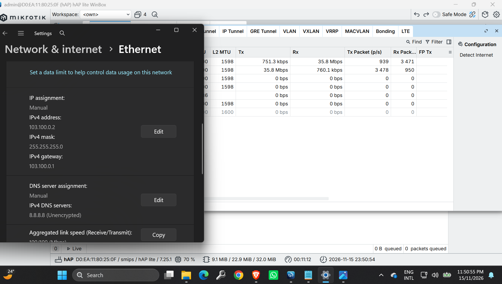
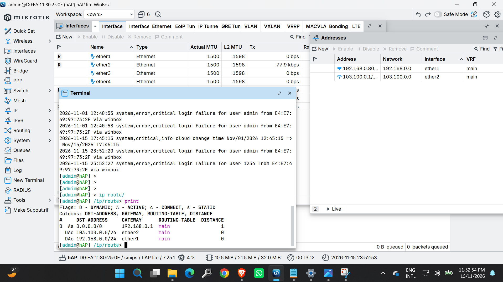
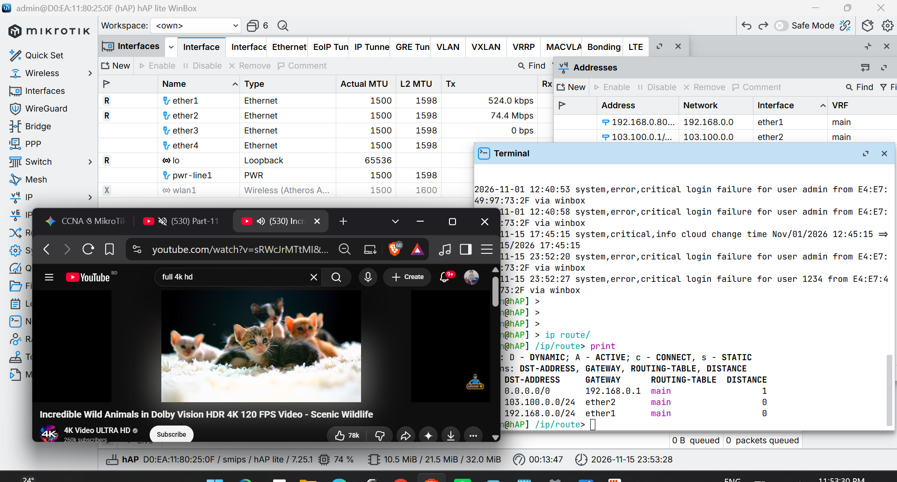

# 🚀 MikroTik RouterOS WAN & LAN Configuration with Unlimited Bandwidth Testing

This repository documents a hands-on networking lab configuring basic **WAN-to-LAN routing**, **NAT (Masquerade)**, and verifying **unthrottled (unlimited) bandwidth throughput** on a **MikroTik hAP lite** router running **RouterOS v7.25.1**.

## 📋 Lab Overview

The objective of this lab is to establish internet connectivity from an upstream ISP gateway to a local area network (LAN) and validate full-speed throughput without any artificial bandwidth limits (Simple Queues).

### 🖥️ Hardware & Software Specifications

* **Router Model:** MikroTik hAP lite (`RB941-2nD`)
* **Operating System:** RouterOS `v7.25.1`
* **Configuration Tools:** WinBox & MikroTik CLI
* **Client OS:** Windows 11

## 🌐 Network Topology & IP Addressing

| Interface / Device | Role | IP Address | Subnet Mask | Gateway | DNS | 
| ----- | ----- | ----- | ----- | ----- | ----- | 
| **`ether1`** | WAN (ISP) | `192.168.0.80/24` | `255.255.255.0` | `192.168.0.1` | `8.8.8.8` | 
| **`ether2`** | LAN | `103.100.0.1/24` | `255.255.255.0` | — | — | 
| **Client PC** | End Device | `103.100.0.2/24` | `255.255.255.0` | `103.100.0.1` | `8.8.8.8` | 

## ⚙️ Step-by-Step CLI Configuration

Below are the exact RouterOS CLI commands used to configure the router:

```routeros
# 1. Assign IP Addresses to WAN and LAN Interfaces
/ip address
add address=192.168.0.80/24 interface=ether1 network=192.168.0.0 comment="WAN Interface"
add address=103.100.0.1/24 interface=ether2 network=103.100.0.0 comment="LAN Interface"

# 2. Configure Default Static Route for Internet Access
/ip route
add dst-address=0.0.0.0/0 gateway=192.168.0.1 comment="Default ISP Gateway"

# 3. Configure DNS Servers
/ip dns
set servers=8.8.8.8,8.8.4.4 allow-remote-requests=yes

# 4. Configure Source NAT (Masquerade) for LAN-to-WAN Translation
/ip firewall nat
add chain=srcnat out-interface=ether1 action=masquerade comment="WAN Masquerade"
```

## 📊 Performance & Throughput Verification

* **Queue Policy:** No Simple Queues or Queue Trees applied (Unlimited / Unthrottled Speed).
* **Stress Test Method:** Streamed **4K HDR 120 FPS** video content on the connected LAN client (`103.100.0.2`).
* **Observed Throughput:** Live interface monitoring in WinBox confirmed smooth, uninterrupted traffic reaching **~74.4 Mbps** on the LAN interface (`ether2`) with zero packet drops.

## 📸 Lab Screenshots

### 1. Client PC Static IP & DNS Configuration


### 2. MikroTik IP Addressing & Routing Table Verification


### 3. 4K Video Streaming & Unlimited Speed Test (~74.4 Mbps)


## 👨‍💻 Author

**S. Sadikul**  
*Aspiring Network Engineer / NOC Engineer*  
*Skills: MikroTik RouterOS | Routing & Switching | CCNA | Network Troubleshooting*